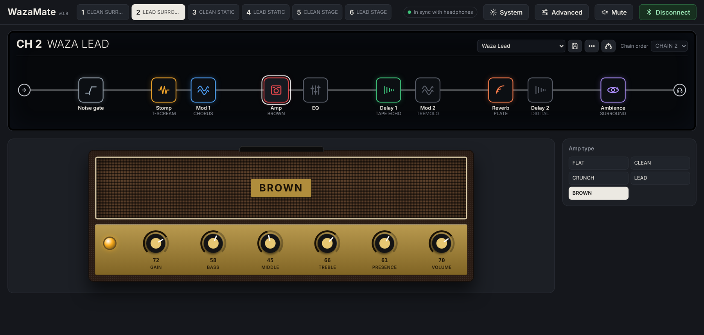
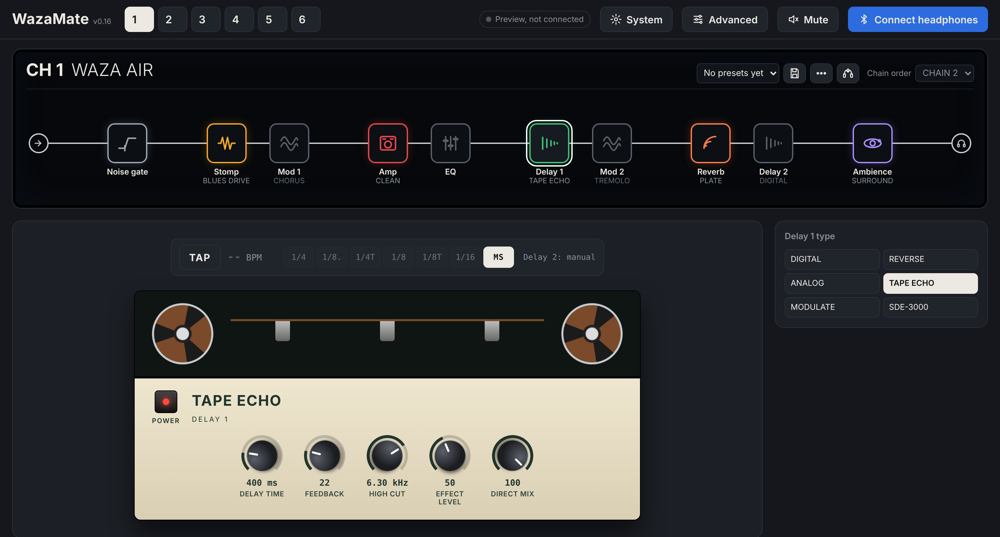
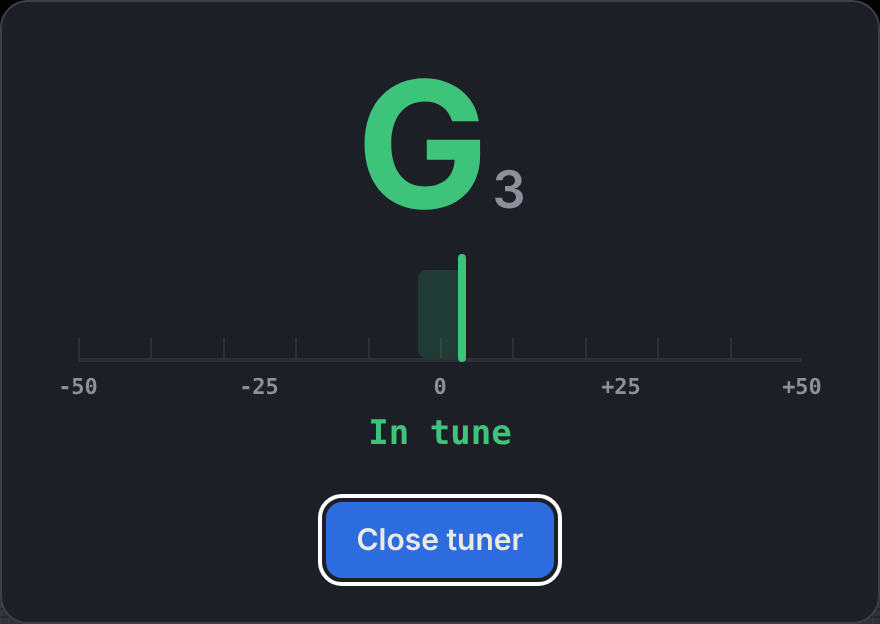
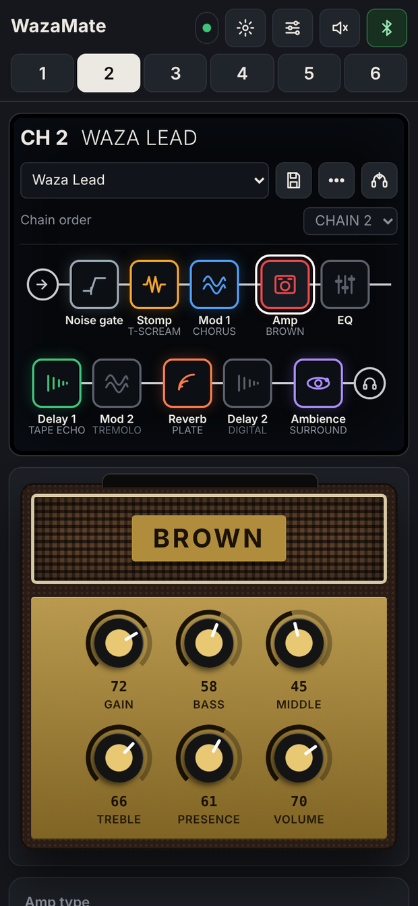
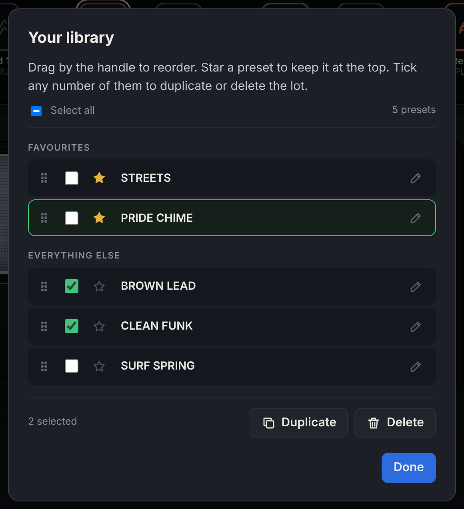

# WazaMate

A web editor for the BOSS WAZA-AIR wireless guitar headphones.

[](https://buymeacoffee.com/peanutismint)

### [Open WazaMate](https://peanutismint.github.io/WazaMate/)

Open one page in your browser, connect over Bluetooth, and get at every amp,
effect and setting the headphones have, laid out as a signal chain you can click
through. No app store, no install, no account.



WazaMate is a single HTML file with no server behind it. The only outbound
connection it ever makes is to an LLM, and only if you choose to set one up.

> Not affiliated with, endorsed by, or supported by Roland or BOSS. WAZA-AIR and
> BOSS are trademarks of their respective owners. This is an independent project
> built for people who own these headphones.

## What it does

**See the whole sound at once.** The signal chain runs along the top: noise
gate, stomp, mod, amp, EQ, delays, reverb and the 3D ambience. Each block shows
what it is set to and whether it is on. Click one to open it.

**Real controls, not a wall of sliders.** Open the stomp block and you get a
pedal with knobs on it. Pick the tape echo and you get a tape machine with
spinning reels. Switch the amp to Brown and the amp changes to match. The
controls are the ones Roland's own editor exposes, grouped the way the gear
would be.



**A preset library the headphones do not have.** The headphones hold six
memories. WazaMate lets you keep as many presets as you like in your browser,
load any of them instantly, and store the one you want into any of the six
memories when you are happy with it.

**Share presets as files.** Export one preset or your whole library to a small
`.json` file and send it to someone. They import it and hear what you heard.

**Tap a tempo.** Tap four times in time with the music. The tempo is shared by
both delays, but each keeps its own note value, so you can run Delay 1 at a
dotted 1/8 against Delay 2 at a 1/4 and re-tap without losing the relationship.

**Tune up.** The tuner button opens the headphones' own tuner: the note, a
needle, and how many cents sharp or flat you are. It turns green when the
headphones count the note as in tune. Your sound keeps playing while it is
open, so you can tune without taking the headphones off.



**Let an LLM build you a patch.** Describe the sound you want, "a chiming
delay-heavy clean tone like The Edge on Pride", and get a patch back that loads
straight away so you can hear it. It explains its choices too, which amp, which
drive, why that delay time, so you can tweak rather than guess.

Two ways to use it, and both are free:

- **Connect an LLM once** under "New patch from an LLM". Paste an API key and
  from then on it is one dialog and a few seconds. Google Gemini has a free tier
  and is the one to start with. It remembers the conversation, so you can say
  "I like this, now give it more delay" and it edits rather than starting over.
- **Or copy and paste.** "Copy prompt for an LLM" copies everything needed into
  your clipboard. Paste it into whatever chatbot you already use, then bring the
  whole reply back with "Paste a patch from an LLM". No key, no setup.

**Follows the headphones.** Change a patch using the button on the headphones
and the screen follows. Turn your head and the ambience view turns with you.

## Getting started

Go to **[wazamate](https://peanutismint.github.io/WazaMate/)** in Chrome or Edge
on a desktop, press **Connect headphones**, and pick WAZA-AIR MIDI. That is the
whole setup.

If you would rather keep a copy, download `index.html` from this repository and
open it from your own machine. It works exactly the same, with one catch covered
under presets below.

Without a connection everything still works in preview mode, so you can build
and export presets with the headphones switched off.

### Browser support

Web Bluetooth is what makes this work, and not every browser has it.



| Where | Works |
| --- | --- |
| Chrome or Edge on Windows, macOS, Linux | Yes |
| Chrome on Android | Yes |
| **Safari or Chrome on iPhone and iPad** | **No** |
| Firefox anywhere | No |

**iPhone and iPad cannot connect.** Apple does not allow Web Bluetooth in any
browser on iOS, and that is not something this project can work around. The
editor, the preset library and import and export all work fine on an iPhone, you
just cannot talk to the headphones. Third party browsers such as Bluefy add Web
Bluetooth on iOS and may work, but that is untested here.

The layout folds down for small screens, so an Android phone is a perfectly good
way to use it.

<br clear="right">

### If Windows refuses to connect

Windows is awkward with Bluetooth MIDI. If you get **"GATT Error: Not paired"**,
this sequence has worked:

1. Turn Bluetooth off and on on the headphones so the blue light flashes.
2. In Windows Settings, Bluetooth & devices, **Add device**, then **Show all
   devices**, and connect to WAZA-AIR MIDI.
3. Open Device Manager, find WAZA-AIR MIDI under Bluetooth, and **uninstall** it.
4. Back in WazaMate, press Connect headphones and pick WAZA-AIR MIDI.

Only one thing can hold the headphones' MIDI connection at a time, so close
Roland's app, and any other browser tab running WazaMate, before connecting.

## Your presets live in your browser

Build up a few sounds and **Manage library** in the preset menu is where you keep
them in order. Drag by the handle to reorder, star the ones you reach for most so
they sit at the top of the dropdown, and tick any number of them to duplicate or
delete the lot in one go.



The rest of this section is the one thing worth knowing before you spend an
evening building sounds.

Presets are saved in your browser's local storage for this page. That means:

- **Clearing your browsing data can delete them.** "Cookies and other site data"
  is usually what does it, and browsers often clear it without making a fuss.
- They belong to one browser on one machine. Presets made in Chrome will not
  appear in Edge, or on your laptop.
- If you run WazaMate from a downloaded file rather than the website, moving or
  renaming that file can leave the old presets behind. The website address stays
  put, so presets made there survive every update.

**So export your library.** Preset menu, **Export whole library**, and keep the
file somewhere safe. It takes two seconds and it is the only real backup there
is.

Before you store anything into the headphones' memories, use **Back up headphone
memories** in the same menu. It reads all six off the headphones and saves them
to a file, so a store you regret can be undone. Storing overwrites whatever was
in that memory, and the factory patches do not come back on their own, short of
a factory reset on the headphones themselves.

## Connecting an LLM

The spark button in the preset bar opens it. Describe a sound, and the patch it
builds starts playing straight away.

That dialog is also where the other two routes live, along the bottom. **Copy
the prompt instead** puts the whole thing on your clipboard for any chatbot, and
**Paste a reply** takes the answer back. Neither needs a key, so the whole
feature works without handing one over.

Model box and WazaMate asks the provider which models your key can actually use,
then lets you pick one. Worth doing on the first run.

If a request fails or just sits there, open the **MIDI log** at the foot of the
page. Every request, reply and failure is written there alongside the MIDI, with
timings and sizes, and never your key. A request that gets no reply within
ninety seconds is dropped rather than left hanging.

Each patch it builds starts from scratch. The six effect slots, the amp and the
patch EQ go back to their defaults and only what the model asked for is switched
on, so a delay left running by the last sound does not follow the next one
around. Your noise gate, ambience and chain order are left as you have them, and
so is the volume, since a new patch should not change how loud the headphones
are.

Nothing it builds goes into your library until you press the save button, so you
can work through ten ideas and keep the one you like.

If you would rather not hand over a key at all, the copy and paste route does
exactly the same job with your existing chatbot.

## Knobs

Drag a knob up and down to change it, hold Shift for fine steps, and double
click to put it back to neutral. For a control that runs either side of zero,
such as a pitch or a tone cut, that means zero; for everything else it means the
value the WAZA-AIR ships with.

## The MIDI log

The bar at the foot of the page holds every message to and from the headphones.
Click it to open, click again to collapse. If something misbehaves, **Copy log**
and sending that over is the fastest way to work out what happened: it carries
the whole conversation, addresses and all.

## Advanced

Under **Advanced**, turn on **Testing tools** to add:

- A console in the log bar for sending raw SysEx by hand.
- Test marks on every control, for tracking what has been confirmed on hardware.
- **Send CONNECT** and **Read state** for re-running the handshake or re-reading
  the headphones by hand.


## Building from source

WazaMate ships as one file so it can be opened straight from disk. That file is
built from `src/`:

```
src/template.html   page structure
src/style.css       all styling
src/app.js          protocol, state and interface
src/schema.json     the parameter data

python3 build.py            writes index.html
python3 build.py --check    fails if index.html is stale
node tools/test.js          checks message encoding against hardware captures
```

Only Python 3 and Node are needed, with no packages to install. If you edit
anything in `src/`, run `build.py` and commit the rebuilt `index.html` too,
since that is the file the site actually serves.

`src/schema.json` is the parameter table: the address, range and display label
for everything the headphones expose. `docs/protocol.md` covers the message
format, the handshake and what has been confirmed on real hardware.

## Support

If WazaMate is useful to you and you would like to chip in towards the domain
and keep it free for everyone, you can
[buy me a coffee](https://buymeacoffee.com/peanutismint). Entirely optional, and
the app will never ask you for anything.

## Licence

MIT, see [LICENSE](LICENSE).
